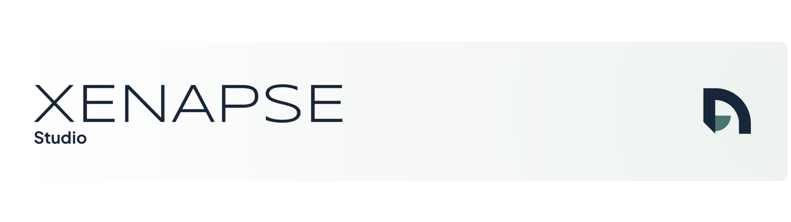
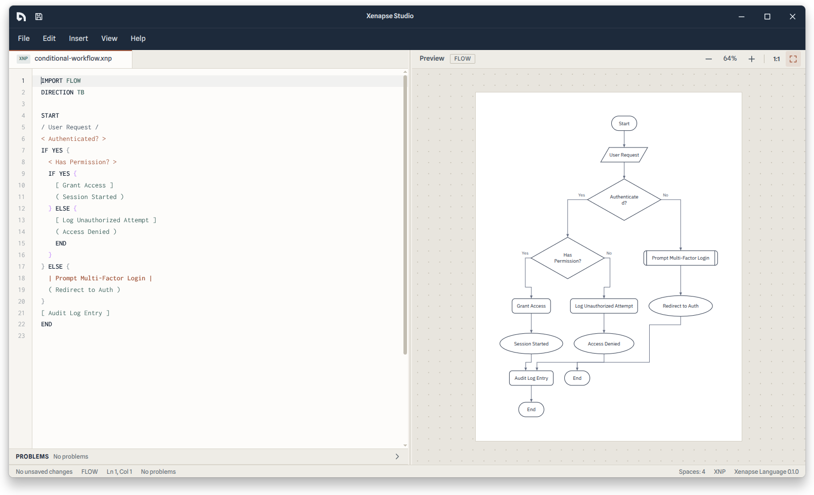
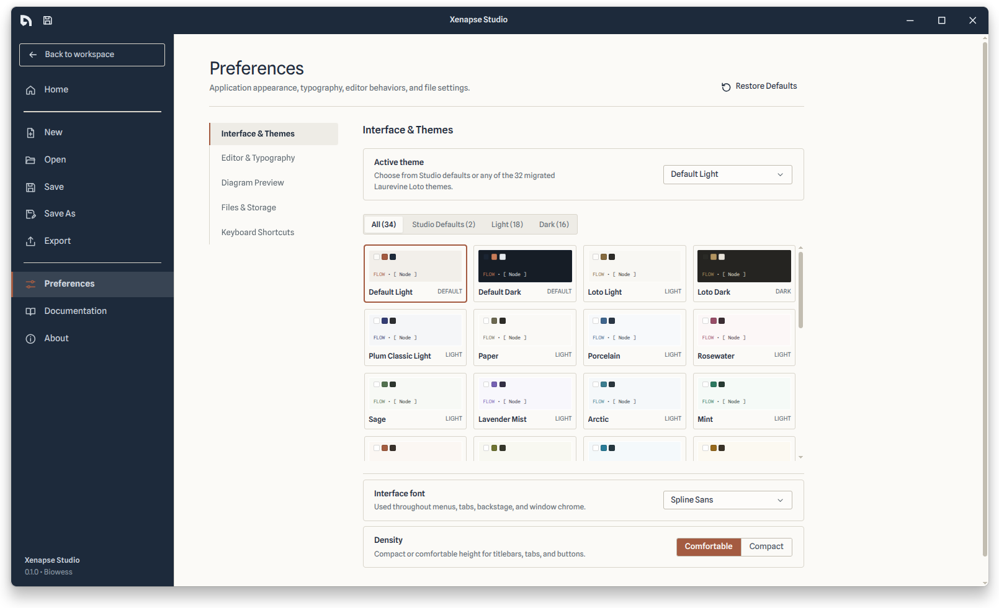
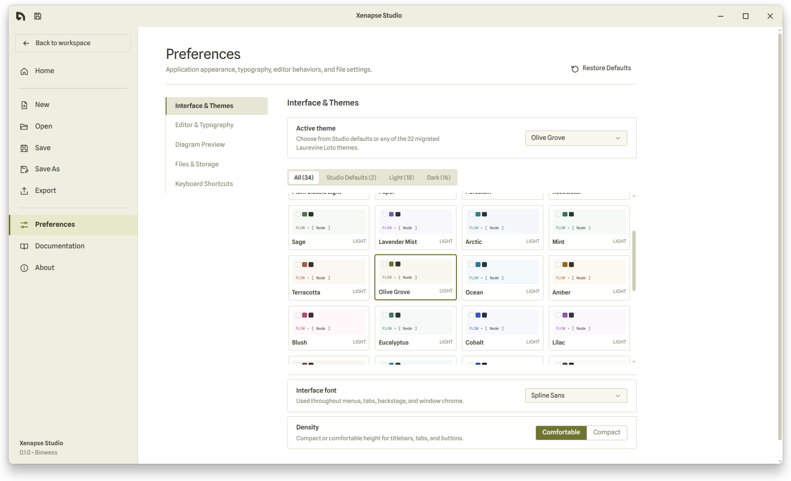
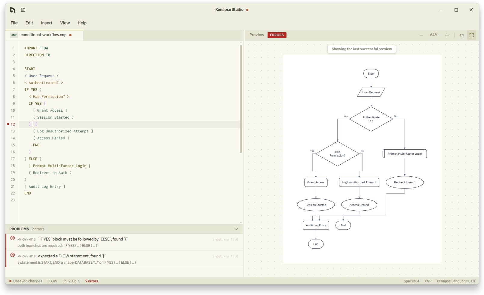

<div align="center">

<!-- Banner Placeholder -->


# Xenapse Studio

### The text-first visual IDE and desktop studio for the Xenapse diagramming language

[](LICENSE)
[](package.json)
[](https://github.com/biowess/xenapse)
[]()
[]()

---

</div>

> **Note on Core Language & Compiler**:  
> **Xenapse Studio** is the dedicated graphic IDE and interactive workbench for authoring diagrams. It does **not** host the compiler or grammar specifications. For the core Xenapse compiler engine, CLI toolchain, Rust crate sources, and language specification (`FLOW` and `MINDMAP`), please refer directly to the official language repository:  
> 🔗 **[github.com/biowess/xenapse](https://github.com/biowess/xenapse)**

---

## Table of Contents

- [Overview](#overview)
- [Reference to the Xenapse Language](#reference-to-the-xenapse-language)
- [Studio Features](#studio-features)
  - [1. Real-Time Split Workspace](#1-real-time-split-workspace)
  - [2. Source Code Editor & Syntax Highlighting](#2-source-code-editor--syntax-highlighting)
  - [3. Interactive Live Canvas & Preview](#3-interactive-live-canvas--preview)
  - [4. Multi-File Tabs & XCSS Lifecycle](#4-multi-file-tabs--xcss-lifecycle)
  - [5. Integrated Find and Replace](#5-integrated-find-and-replace)
  - [6. Real-Time Diagnostics & Problems Panel](#6-real-time-diagnostics--problems-panel)
  - [7. Backstage Hub](#7-backstage-hub)
  - [8. Deep Theming & Bundled Typography](#8-deep-theming--bundled-typography)
  - [9. Export Options](#9-export-options)
- [Screenshots & Visuals](#screenshots--visuals)
- [Getting Started](#getting-started)
  - [Running as a Desktop App (Electron)](#running-as-a-desktop-app-electron)
  - [Running in a Web Browser (Zero Build Step)](#running-in-a-web-browser-zero-build-step)
- [Keyboard Shortcuts](#keyboard-shortcuts)
- [Project Architecture](#project-architecture)
- [Trademark & License](#trademark--license)

---

## Overview

**Xenapse Studio** provides a dedicated, lightweight, and responsive development environment engineered specifically for writing text-based Xenapse diagrams (`.xnp`) and styling them with Xenapse Cascading Style Sheets (`.xcss`).

By pairing immediate visual feedback with precision source editing, Xenapse Studio bridges the gap between text-first diagram definition and polished visual output. It runs natively as a desktop application powered by Electron, and can also run statically inside modern web browsers with zero build tools or complex toolchains required.

---

## Reference to the Xenapse Language

Xenapse is an expressive, text-first diagramming language and compiler that transforms declarative text into deterministic, pixel-perfect SVG graphs.

```xnp
IMPORT FLOW
START
< Is the diagram clear? >
IF YES { [ Ship to production ] } ELSE { [ Refine in Studio ] }
END
```

* **Core Language Repository**: [https://github.com/biowess/xenapse](https://github.com/biowess/xenapse)
* **Supported Diagram Modules**: `FLOW` (flowcharts, sequence branches, decision logic) and `MINDMAP` (hierarchical idea maps, branches, and leaves).
* **Styling**: `.xcss` stylesheets defining node shapes, colors, stroke widths, typography, and connector routing.
* **CLI & Rust Crates**: The compiler and headless build tools (`xenapse compile`, `xenapse check`) are hosted and maintained in the primary language repo.

---

## Studio Features

```
┌───────────────────────────────── Xenapse Studio ─────────────────────────────────┐
│ [Brand] [Save]  Document: architecture.xnp                      [—] [口] [X]     │
├──────────────────────────────────────────────────────────────────────────────────┤
│ File   Edit   Insert   View   Help                                               │
├────────────────────────────────────────┬─────────────────────────────────────────┤
│ [main.xnp] [styles.xcss]               │ Preview               [ - ] 100% [ + ]  │
│ 1 │ IMPORT FLOW                        │                                         │
│ 2 │ START                              │            ┌─────────────┐              │
│ 3 │ [ Client App ]                     │            │ Client App  │              │
│ 4 │   -> [ Gateway ]                   │            └──────┬──────┘              │
│ 5 │        -> [ Microservice ]         │                   ▼                     │
│ 6 │ END                                │            ┌─────────────┐              │
│                                        │            │   Gateway   │              │
├────────────────────────────────────────┤            └──────┬──────┘              │
│ Problems (0)                           │                   ▼                     │
│ No issues detected in document         │            ┌─────────────┐              │
│                                        │            │Microservice │              │
│                                        │            └─────────────┘              │
├────────────────────────────────────────┴─────────────────────────────────────────┤
│ Ready | Ln 5, Col 23 | Spaces: 2 | UTF-8 | Engine: Connected (Rust-WASM / Mock)  │
└──────────────────────────────────────────────────────────────────────────────────┘
```

### 1. Real-Time Split Workspace
* **Side-by-side editing**: Instant split-pane layout displaying source code on the left and live vector rendering on the right.
* **Draggable divider**: Fluid splitter allowing users to adjust the balance between code and visual canvas to fit any screen resolution or aspect ratio.
* **Collapsible panels**: Minimize the problems drawer or collapse the preview entirely when focusing exclusively on writing.

### 2. Source Code Editor & Syntax Highlighting
* **Custom Syntax Highlighting**: Handcrafted syntax engine tailored specifically for `.xnp` diagram grammar keywords (`IMPORT`, `START`, `END`, `IF`, `ELSE`, `ROOT`, `BRANCH`, `LEAF`, identifiers, brackets, strings) and `.xcss` style rules.
* **Editor ergonomics**: Line numbering gutter, active line highlighting, auto-indentation, bracket matching, soft tabs, and smooth scrolling.
* **Insert Snippets**: Fast insertion templates for standard flow blocks, conditionals, connections, mindmap roots, and stylesheet boilerplate.

### 3. Interactive Live Canvas & Preview
* **Deterministic Vector Rendering**: Accurate SVG preview matching compiler output.
* **Zoom & Pan Navigation**: Smooth canvas zooming from 25% up to 400%, with dedicated buttons for Zoom In, Zoom Out, 1:1 Actual Size, and Fit-to-View.
* **Background Stage**: Clean grid/stage styling ensuring diagram readability across both light and dark themes.

### 4. Multi-File Tabs & XCSS Lifecycle
* **Tabbed Interface**: Work on multiple documents simultaneously, toggling seamlessly between `.xnp` diagram source and accompanying `.xcss` stylesheets.
* **Automatic Stylesheet Linking**: Studio recognizes `@import` and `STYLESHEET` declarations, hot-reloading styles into the diagram canvas upon editing.

### 5. Integrated Find and Replace
* **Keyboard-driven search**: Open via `Ctrl+F` (`Cmd+F`) with match counter and previous/next navigation.
* **Replace functionality**: `Ctrl+H` (`Cmd+H`) reveals single replace and batch replace-all.
* **Match options**: Instant toggle for case sensitivity (`Aa`).

### 6. Real-Time Diagnostics & Problems Panel
* **Live syntax checking**: Surfaces compile errors, missing nodes, invalid connections, and unknown style properties.
* **Click-to-jump**: Selecting any diagnostic item in the Problems list navigates the editor cursor directly to the offending line and column.
* **Status bar summary**: At-a-glance error count badge in the footer.

### 7. Backstage Hub
* **File Operations**: Full-screen backstage interface for New, Open, Save, and Save As workflows.
* **Template Gallery**: Pre-populated starters for system architectures, workflow logic, organizational trees, and mind maps.
* **Sample Browser**: Explore pre-built diagrams demonstrating language features and visual design possibilities.
* **Preferences & Settings**: Manage editor fonts, font size, tab size, live compile delays, auto-save, and interface themes.
* **About Screen**: Detailed versioning, copyright information, third-party acknowledgments, and direct links to language resources.

### 8. Deep Theming & Bundled Typography
* **Color Themes**: Native support for **Light** and **Dark** modes with refined surface palettes.
* **Accent Colors**: Multiple UI accents including Orange, Blue, Green, Purple, and Monochrome.
* **Interface Densities**: Comfortable and Compact layout modes to suit user preferences.
* **40 Bundled Open Font License (OFL) Typefaces**: Includes premier programming and UI fonts ready offline:
  * *Code*: `JetBrains Mono` (default), `Fira Code`, `Source Code Pro`, `Inconsolata`, `Space Mono`
  * *Interface*: `Spline Sans` (default), `Inter`, `Outfit`, `Roboto`, `Open Sans`, `Plus Jakarta Sans`
  * *Serif & Editorial*: `EB Garamond`, `Merriweather`, `Playfair Display`, `Bitter`

### 9. Export Options
* **Vector SVG**: Export crisp, scalable, standalone vector SVG files ready for web embedding, documentation, or publications.
* **Raster PNG**: High-resolution raster rendering for slides, chat apps, and presentations.
* **Source Archive**: Package your `.xnp` and `.xcss` assets together with ease.

---

## Screenshots & Visuals

> *Screenshots below represent the Xenapse Studio interface.*

#### Main Split Editor & Diagram Preview

<p align="center">
  
</p>

#### Backstage Preferences & Theme Customization

<p align="center">
  
</p>

<p align="center">
  
</p>

#### Real-Time Problems & Diagnostics Drawer

<p align="center">
  
</p>

---

## Getting Started

### Running as a Desktop App (Electron)

Xenapse Studio is packaged with Electron for a native desktop experience with local filesystem access:

```bash
# Clone the studio repository
git clone https://github.com/biowess/xenapse-studio.git
cd xenapse-studio

# Install development dependencies
npm install

# Launch Xenapse Studio
npm start

# Or launch with DevTools detached for development
npm run dev
```

### Running in a Web Browser (Zero Build Step)

Xenapse Studio is crafted using clean, modern standards: semantic HTML5, modular CSS, and vanilla ES modules. There is **no build step**, no webpack, and no bundler required.

1. Open `index.html` directly in any modern browser (Chrome, Firefox, Safari, Edge):
   ```bash
   # Or serve statically using any standard local server
   python3 -m http.server 8080
   # Then visit http://localhost:8080 in your browser
   ```
2. When running in a browser:
   * **Open**: Use the file picker or drag-and-drop `.xnp` and `.xcss` files directly onto the window.
   * **Save**: Triggers standard browser file downloads.

---

## Keyboard Shortcuts

| Shortcut (Win / Linux) | Shortcut (macOS) | Action |
| :--- | :--- | :--- |
| `Ctrl + S` | `Cmd + S` | Save current file |
| `Ctrl + O` | `Cmd + O` | Open file / backstage |
| `Ctrl + N` | `Cmd + N` | New document |
| `Ctrl + F` | `Cmd + F` | Open Find bar |
| `Ctrl + H` | `Cmd + H` | Open Find & Replace bar |
| `Ctrl + Z` | `Cmd + Z` | Undo |
| `Ctrl + Y` / `Ctrl + Shift + Z` | `Cmd + Shift + Z` | Redo |
| `Ctrl + +` / `Ctrl + =` | `Cmd + +` | Zoom In canvas |
| `Ctrl + -` | `Cmd + -` | Zoom Out canvas |
| `Ctrl + 0` | `Cmd + 0` | Reset zoom to 100% |
| `Ctrl + 9` | `Cmd + 9` | Fit diagram to view |
| `Escape` | `Escape` | Close dialogs / backstage / search |

---

## Project Architecture

The studio is organized into clean, modular layers:

```
xenapse-studio/
├── index.html                   # Core application entry shell
├── package.json                 # Desktop application manifest
├── electron/                    # Electron main & preload scripts
│   ├── main.js
│   └── preload.js
├── assets/
│   ├── brand/                   # Official logos, wordmarks & symbols
│   └── splash.png               # Desktop splash graphic
├── css/
│   ├── foundations/             # Tokens, typography, reset & base styles
│   ├── themes/                  # Light and dark themes & color accents
│   ├── layout/                  # Workspace grid, split-panes, topbar & statusbar
│   ├── components/              # Buttons, inputs, tabs, dialogs, findbar
│   └── pages/                   # Backstage & welcome screen layouts
├── js/
│   ├── core/                    # State store, event bus, command dispatcher
│   ├── services/                # File services, preferences, compiler engine adapter
│   ├── features/                # Editor, syntax highlighter, preview, diagnostics
│   ├── backstage/               # Backstage shell, settings panels & templates
│   └── app.js                   # Application bootstrap
└── fonts/                       # 40 bundled OFL typography families
```

### Compiler Integration
The Studio frontend talks to the language engine through `js/services/engine-adapter.js`. In full desktop deployments, this adapter connects directly to the compiled Xenapse Rust engine via WebAssembly (WASM) or native Electron IPC bindings.

---

## Trademark & License

### Source Code License
The source code of Xenapse Studio is open source and licensed under the **Apache License, Version 2.0**.  
See the [LICENSE](LICENSE) file for complete terms.

### Brand Assets Policy
The Xenapse Studio **application icon**, **wordmark**, and **splash screen artwork** are reserved brand assets of Biowess and are **not** covered by the Apache-2.0 license. The name "Xenapse" and "Xenapse Studio" is not a registered trademark, but forks are asked (as a project policy) to ship under a different product name to avoid user confusion.  
Please consult [TRADEMARK.md](TRADEMARK.md) for usage permissions and guidelines.

---

<div align="center">

**Xenapse Studio** is maintained by **Biowess**  
Language & Engine: [github.com/biowess/xenapse](https://github.com/biowess/xenapse)

</div>
